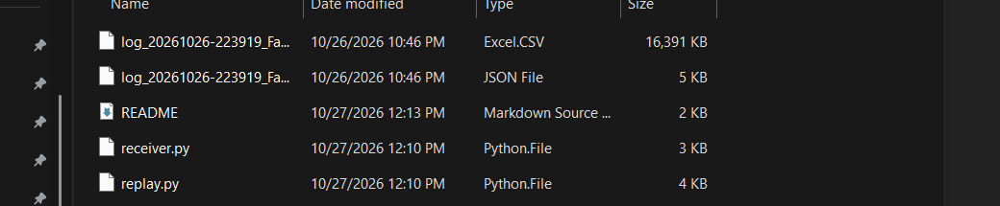

## Test tools

Two scripts to check the UDP stream (TX mode) without other software or the simulator running.

#### Requirements

- Apex Datalogger v0.2.6+
- Python 3+

### Test UDP packets 

`receiver.py` listens for TX packets and prints them directly in the console.

Run
```
python test/receiver.py
```

| Option | Default | Meaning |
|---|---|---|
| `--host` | `127.0.0.1` | Address to listen on. Use `0.0.0.0` to receive from another PC. |
| `--port` | `9996` | Port to listen on. |
| `--stats` | off | Print the packets per second of each group instead of every packet. |

It also reports:
- Lost packets, from gaps in the sequence number.
- A sequence restart, when TX is turned off and on again or its target changes.
- Packets in another format or protocol version, as unknown.
- A summary when stopped with Ctrl+C.

### Test a LOG file

`replay.py` streams a recorded CSV stint over UDP in the TX format in real time. Use it to develop a receiver without running the game.

> Note: You will need a stint recorded from the datalogger

Logs are not tracked by git. Copy a stint, its CSV and its JSON, from `apps/lua/apex/laps/` to this `test/` folder. The script plays the newest stint it finds here.



Run
```
python test/replay.py
python test/replay.py --speed 2 --loop
```

| Option | Default | Meaning |
|---|---|---|
| `path` | this folder | A stint JSON or CSV, or another folder with stints. |
| `--host` | `127.0.0.1` | Target address. |
| `--port` | `9996` | Target port. |
| `--speed` | `1` | Playback speed. |
| `--loop` | off | Start over at the end of the stint. |

The replayed stream differs from the game stream in a few fields:
- `sessionTimeLeft` is always `0`, because the stint CSV does not record it.
- `clock` is the stint time, so it starts at 0. With `--loop` it keeps increasing across loops.
- Values keep the log precision (9 significant digits) instead of Lua's default number format.
- Only the groups recorded in the stint are sent, at the rates in its JSON.
- Only stint logs (`formatVersion` 2) are supported.

To check the whole chain, run `receiver.py` in one terminal and `replay.py` in another.
